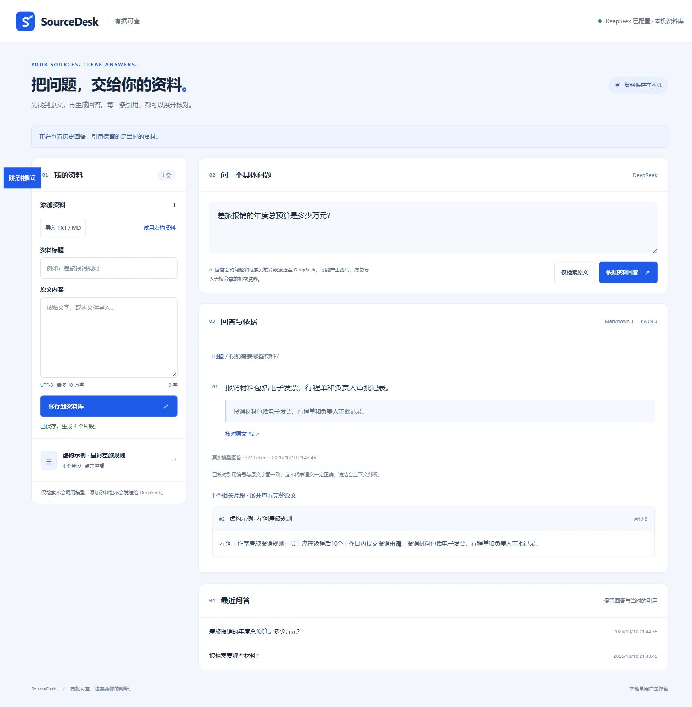

# SourceDesk

基于 DeepSeek 初版 `kb-qa` 改进的本地资料问答工具。导入文字 → 检索相关片段 → DeepSeek 生成有引用的回答 → 对照原文核查与导出。

初版由 DeepSeek 协作实现；本轮由 Codex 协作改进分块、检索、结构化引用校验、本机安全边界、历史保存与界面。它是轻量词法检索应用，不是向量知识库，也不承诺回答准确率。

## 运行

需要 Python 3.10 或以上。

```powershell
py -3 -m pip install -r requirements.txt
py -3 app.py
```

打开 `http://127.0.0.1:5193/`。Windows 也可双击 `start.cmd`；如果本目录已有 `.venv`，启动脚本优先使用它。本应用不创建或覆盖已有虚拟环境。

应用继承当前进程的 `DEEPSEEK_API_KEY`。有密钥时可真实提问，调用可能产生费用；无密钥时仍可保存资料、查看原文、关键词检索。不会自动调用模型，不会自动重试，不提供假 AI 回放。

请求失败后先查看“最近问答”，再决定是否手动重试。网络断开不代表服务没有完成：回答可能已经保存在本机，模型也可能已计费。目前只阻止同时提问，没有跨请求去重；再次提交同一个问题可能再次产生费用。

默认仅绑定 `127.0.0.1`，关闭调试。不要将其暴露到公网或直接套反向代理；它没有多用户账户系统。

## 使用

1. 粘贴资料，或选择 UTF-8 `.txt` / `.md` 文件，检查内容后保存。
2. 提问，例如“报销需要哪些材料？”。“仅检索原文”不调用模型；“依据资料回答”会将问题与最多5个相关片段发送至 DeepSeek。
3. 每条回答包含原文引用；点击引用展开完整片段，核对上下文。资料没有依据时拒答。
4. 下载 Markdown / JSON，或从“最近问答”重新打开。资料原文也可查看、下载、删除。

“试用虚构资料”只填写导入表单，需点击保存；示例明确标注虚构，没有预先生成的答案。

## 数据与兼容

- SQLite 默认路径 `data/kb.db`；已有 `documents` / `chunks` 数据结构和 ID 保留，不清库、不重新分块旧资料。
- 新增 `document_originals` 保存新资料的提交文本；旧资料只保留了片段，查看时会明确标注“片段重组”，不声称恢复原始排版。
- 新增 `answer_history` 保存回答、检索片段快照、模型名称和 token 用量；删除文档不会删除既有历史快照。
- 界面显示最近100条问答；更早记录仍在数据库内。导出历史引用是当时的快照，可能与后续文档状态不同。
- `data/`、日志、环境、密钥及旧私人文档不进入 Git。备份时先停止服务，再复制整个 `data/` 文件夹。
- 浏览器文本框可能统一换行格式；服务端按提交文本保留新文档原文。检索分块会规范 CRLF 并去段落边缘空白。

## 原理与可修改位置

`static/app.js → app.py → core.py → DeepSeek 官方 chat/completions → 引用校验 → SQLite 历史 → 页面/导出`。

- `core.py: SYSTEM_PROMPT`：回答格式与拒答规则。
- `split_chunks`：优先句段边界，每片段最多700字符，超长句才硬切。
- `terms / retrieve`：英文完整词、中文二元组；过滤常见问句词，按词在资料库中的稀有程度加权，最低覆盖门槛 `MIN_COVERAGE=0.35`，最多 `TOP_K=5`。
- `validate_answer`：只接受结构化 `claims`，每项需有整数 `chunk_id` 和该片段中精确存在的连续 `quote`。引用不合法则整条回答不采用，不生成无引用的补充答案。
- `call_provider`：官方 `https://api.deepseek.com/chat/completions`；模型 `deepseek-chat`，`max_tokens=1800`，超时45秒，响应体最多256 KiB，无自动重试。异常不返回供应商原始响应、密钥或堆栈。
- `app.py: create_app(config)`：可注入 `DATABASE` 与 `PROVIDER(question, sources)`，测试使用临时数据库和明确的测试 provider。

**限制：** 字面引用存在只证明“引用确实在原文里”，不证明回答的语义必然受引用支持。模型仍可能误解或受资料中的指令干扰，需要人工核对。词法检索可能漏掉同义词、跨片段结论或只有单个汉字的查询；阈值不是准确率保证。无匹配片段不调用模型，有匹配但无答案时依赖模型拒答。适合小型本机资料库，每文档最多10万字符，全库最多2万个片段。

## 检查

```powershell
py -3 -m unittest discover -s tests -v
node --check static/app.js
```

17项自动检查全部使用临时数据库、注入 provider 或拦截的 HTTP 响应，不需要密钥、不调用外网。覆盖旧数据兼容、导入/删除/历史/导出、精确引用、无关问题、有检索结果仍拒答、数字与类型边界、并发请求、响应限制及错误脱敏。Node 只用于前端语法检查，运行网站不需要 Node。

接口契约：

```text
GET /api/bootstrap -> {token, configured, model}
POST /api/documents {title, content}
GET /api/documents
GET /api/documents/{id}
DELETE /api/documents/{id}
POST /api/search {question}
POST /api/ask {question}
GET /api/history
GET /api/history/{id}
GET /api/history/{id}/export?format=md|json
```

所有写请求要求 `X-SourceDesk-Token`，从 bootstrap 获取；Host 和 Origin 限制到本机同源。API 处理有界输入，界面将资料/模型文字以纯文本呈现。

## 发布与验收边界

仓库仅包含应用代码、模板、静态资源、测试和运行文档；现有私人资料没有复制进样例。GitHub 上提供源码，访问仓库不等于在线问答服务。

本轮单元和接口测试不代表实际 DeepSeek 调用、浏览器验收或已发布成功；这些需要单独记录真实执行证据。自动 CI 工作流检查 Ubuntu/Windows 与 Python 3.10/3.13，仓库首次运行前不能声称 CI 已通过。

## 实际验收

[真实调用记录](VALIDATION.md)


